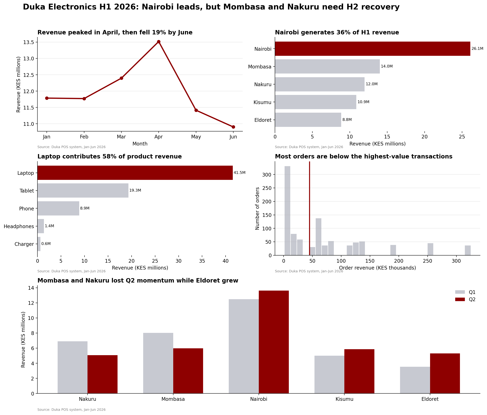

# One-Page Visual Report for the Duka Electronics Board

## Final One-Page Report

## Board Summary

Duka Electronics generated KES 71.8 million in H1 2026, with Nairobi contributing the largest share of revenue. Sales peaked in April before weakening in May and June, signalling softer momentum entering H2. Laptops remained the strongest product category by revenue, while tablets ranked second. Branch performance was uneven: Nairobi remained dominant, while Mombasa and Nakuru weakened in Q2 compared with Q1. Eldoret and Kisumu showed stronger momentum and should be protected while recovery actions are tested elsewhere. The board should prioritise targeted promotions and local sales interventions in Mombasa and Nakuru, while continuing to support branches that are growing. Management should also monitor monthly revenue, branch performance, product mix and channel performance through the Looker Studio dashboard. This will help the board respond quickly if H2 trends worsen, allocate marketing resources more effectively, protect profitable momentum, and identify whether recovery actions are producing measurable improvements before the end of the year.
