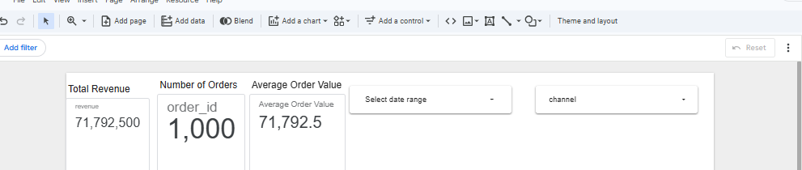
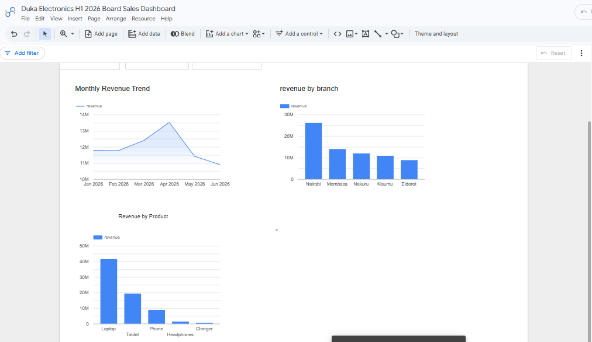

# Duka Electronics H1 2026 Board Sales Dashboard

## Public Looker Studio Dashboard

https://datastudio.google.com/reporting/9990f517-734a-447c-893d-30e1259f7710

## Dashboard Summary

The dashboard provides an interactive view of Duka Electronics H1 2026 sales performance. It includes three KPI scorecards for total revenue, number of orders and average order value, a monthly revenue trend, revenue breakdowns by branch and product, a date-range control and a channel filter.

## Screenshots

### Dashboard Overview

### Dashboard Breakdowns

